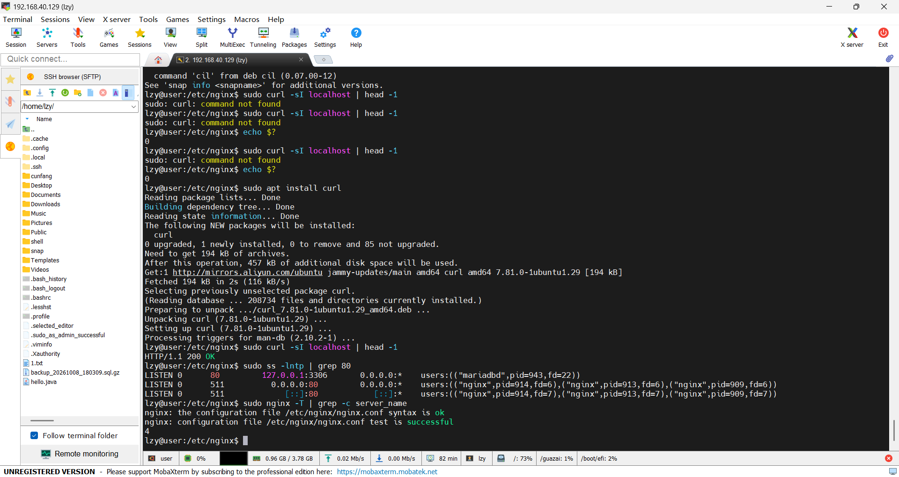
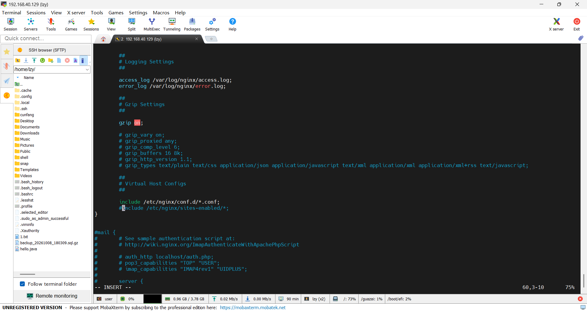
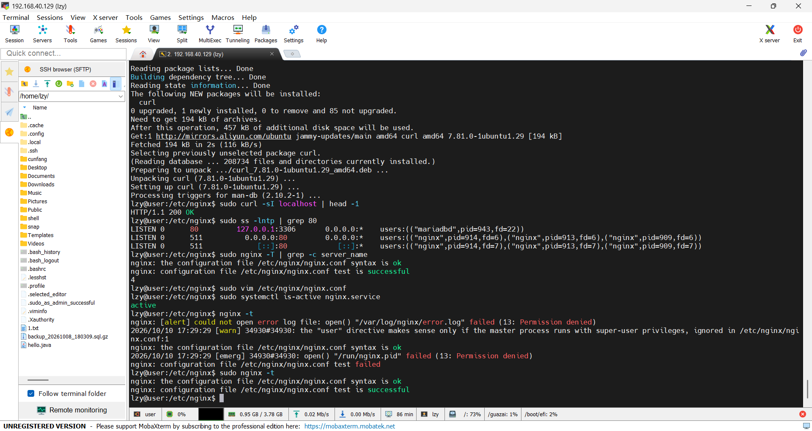
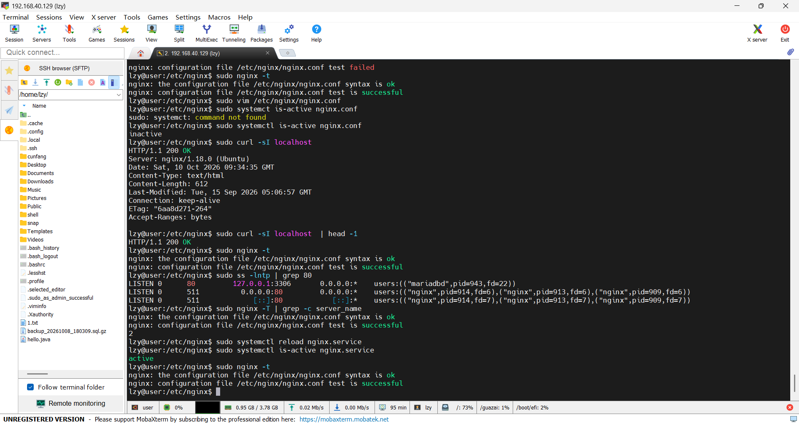
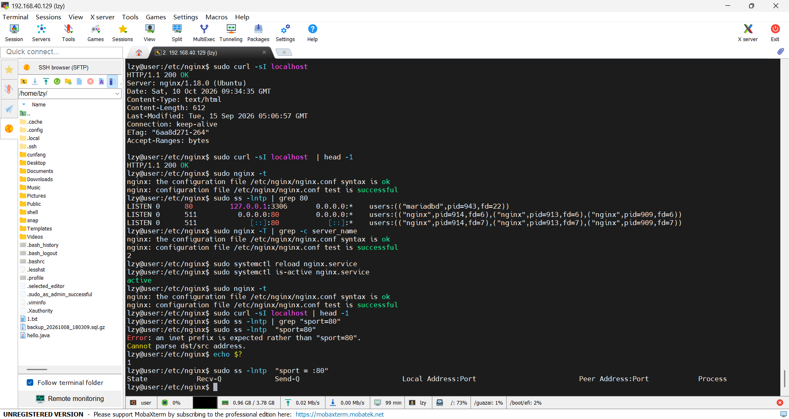
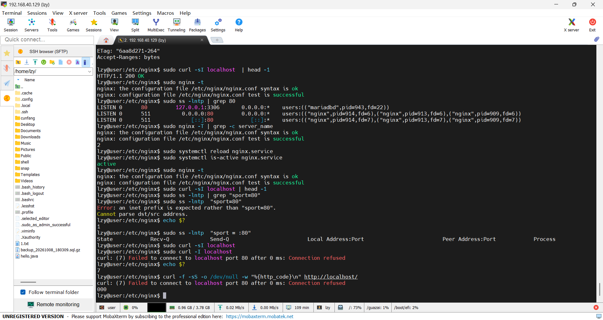
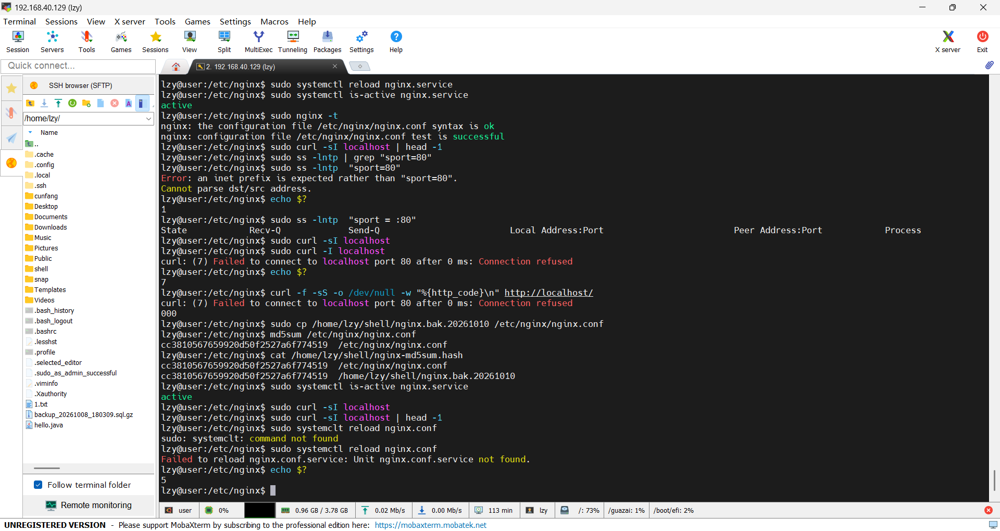
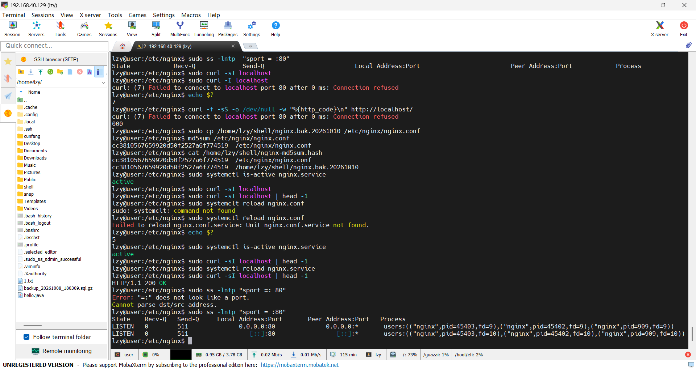

# nginx 配置故障排查记录:配置合法,但不生效

环境:Ubuntu 22.04(VMware 虚拟机)· nginx 1.18.0 (Ubuntu)
时间:2026-10-10 17:21 ~ 17:58(约 37 分钟)

---

## 一、背景与目标

这是阶段 0 的排障练习。目标不是"把 nginx 改坏",而是完整走一遍:

**制造故障 → 观察现象 → 定位根因 → 恢复 → 验证恢复干净**

本次故意制造的故障类型是:**配置语法完全合法,但服务行为不对。**这是四种服务故障里最难察觉的一种——因为所有的语法检查都会通过。

---

## 二、基线:先记录"正常"长什么样

任何排查的前提是知道正常状态。四条命令分别对应四个层次:

```bash
sudo systemctl is-active nginx          # 进程层
curl -sI localhost | head -1            # 应用层
sudo ss -lntp 'sport = :80'             # 端口层
sudo nginx -T | grep -c server_name     # 配置层
```

| 层次 | 命令 | 基线结果 |
| --- | --- | --- |
| 进程 | `systemctl is-active nginx` | `active` |
| 应用 | `curl -sI localhost` | `HTTP/1.1 200 OK` |
| 端口 | `ss -lntp 'sport = :80'` | `0.0.0.0:80` 与 `[::]:80`,由 nginx 监听 |
| 配置 | `nginx -T` | `server_name` 出现 4 次 |

基线被保存成文件,作为事后对照的证据:

```bash
{ echo "=== is-active ==="; sudo systemctl is-active nginx
  echo "=== curl ==="; curl -sI localhost | head -1
  echo "=== listen ==="; sudo ss -lntp 'sport = :80'
  echo "=== server_name count ==="; sudo nginx -T 2>/dev/null | grep -c server_name
} 2>&1 | tee ~/shell/nginx-baseline-20261010.txt
```



---

## 三、备份与指纹

改配置之前先备份,并记录指纹,以便事后验证恢复是否干净:

```bash
sudo cp -a /etc/nginx/nginx.conf /home/lzy/shell/nginx.bak.20261010
md5sum /etc/nginx/nginx.conf /home/lzy/shell/nginx.bak.20261010 | tee ~/shell/nginx-md5sum.hash
```

两个文件的指纹一致:`cc3810567659920d50f2527a6f774519`

> 这一步在执行过程中撞上了一个独立的权限问题,已单独记录在《一次文件权限问题的排查记录》中。

---

## 四、预测(动手之前先写下预期)

> ⚠️ **待补**:这一节需要补上你当时的三条预测——注释掉 include 之后,你原本以为 `nginx -t`、`systemctl status`、`curl` 分别会是什么结果。
> 记录里最有价值的就是"预测和实际不一致"的地方,不要跳过。

---

## 五、植入故障

Ubuntu 把默认站点放在 `/etc/nginx/sites-enabled/default`,由主配置的这一行引入:

```
include /etc/nginx/sites-enabled/*;
```

把它注释掉,站点配置就不会被加载:

```bash
grep -n "sites-enabled" /etc/nginx/nginx.conf     # 先定位行号
sudo vim /etc/nginx/nginx.conf                     # 在行首加 #
```

改完之后**先确认改对地方**:

```bash
diff /home/lzy/shell/nginx.bak.20261010 /etc/nginx/nginx.conf
```

输出只有一行差异,而且正是 `sites-enabled` 那一行。



---

## 六、排查过程中撞上的第一个假故障

```bash
nginx -t
# nginx: [alert] could not open error log file: open() "/var/log/nginx/error.log" failed (13: Permission denied)
# nginx: [emerg] open() "/run/nginx.pid" failed (13: Permission denied)
# nginx: configuration file /etc/nginx/nginx.conf test failed

sudo nginx -t
# nginx: configuration file /etc/nginx/nginx.conf test is successful
```

**同一个配置,加不加 sudo 结论完全相反。**

原因:`nginx -t` 不只是读配置文件,它会完整走一遍启动流程,包括打开 error log 和写 pid 文件。这些文件属主是 root,普通用户打不开,于是测试"失败"——**但这个失败和配置无关。**

**判据:看报错里的路径指向哪一层。**

| 报错里的路径 | 说明问题在 |
| --- | --- |
| 配置文件本身,且带**行号** | 配置语法 |
| 日志、pid、socket 等**运行时文件** | 权限 / 环境 |
| 数据目录 | 权限 / 磁盘 |



---

## 七、第一层错位:文件改了,但服务还在用旧配置

改完文件、**还没有 reload** 时的现象:

```bash
sudo ss -lntp | grep 80
# LISTEN 0 511 0.0.0.0:80 ... users:(("nginx",pid=914 ...),("nginx",pid=913 ...),("nginx",pid=909 ...))

sudo curl -sI localhost | head -1
# HTTP/1.1 200 OK

sudo nginx -T | grep -c server_name
# 2
```

**配置文件已经变了(计数从 4 掉到 2),但服务照常工作。**

因为运行中的 nginx 用的是**内存里已加载的配置**;而 `nginx -T` 读的是**磁盘上的文件**。两者是两个独立的状态。

> 顺带:这个 `2` 不是 0,因为 `grep -c server_name` 把 nginx.conf 里两行**被注释掉**的配置也算进去了。更精确的指标是数 server 块:`nginx -T | grep -cE '^\s*server\s*\{'`。



---

## 八、reload 之后:故障生效

```bash
sudo systemctl reload nginx
```

**reload 成功时没有任何输出**——Unix 的惯例是"没有消息就是好消息"。

四条证据:

```bash
sudo systemctl is-active nginx        # active          ← 服务是活的
sudo ss -lntp 'sport = :80'           # 只有表头,零条   ← 端口是死的
curl -I localhost                     # curl: (7) Failed to connect ... Connection refused
echo $?                               # 7
sudo nginx -T | grep -c server_name   # 配置里已经没有站点
```

| 层次 | 结果 | 结论 |
| --- | --- | --- |
| 进程 | `active (running)` | 服务活着 |
| 端口 | 表头有、数据行 0 条 | **什么都不监听** |
| 应用 | `curl: (7) Connection refused` | 用户访问不了 |
| 配置 | server 块被移除 | 根本没有站点 |

**服务是活的,但什么也不干。**如果只看 `systemctl` 的输出,会得出"一切正常"的错误结论——这正是四层检查存在的意义。



---

## 九、根因

`/etc/nginx/nginx.conf` 里这一行被注释掉了:

```
#include /etc/nginx/sites-enabled/*;
```

没有任何 `server` 块的配置是**语法完全合法的**——所以 `nginx -t` 通过、服务正常启动、master 进程照常运行。但因为没有 `listen` 指令,nginx **不会去绑定 80 端口**。

**这就是"配置合法但不生效":所有检查都通过,但服务不干活。**这类故障必须靠"行为与预期不符"来发现,而不是靠报错。

---

## 十、恢复与验证

```bash
sudo cp -a /home/lzy/shell/nginx.bak.20261010 /etc/nginx/nginx.conf
sudo md5sum /etc/nginx/nginx.conf
# cc3810567659920d50f2527a6f774519   ← 与备份前记录的值一致
cat /home/lzy/shell/nginx-md5sum.hash
```



确认指纹一致之后,再让它生效并验证:

```bash
sudo nginx -t && sudo systemctl reload nginx

curl -sI localhost | head -1
# HTTP/1.1 200 OK                              ← 同一命令,恢复前是空
sudo ss -lntp 'sport = :80'
# LISTEN ... 0.0.0.0:80 ... users:(("nginx", ...))   ← 监听回来了
```

**用完全相同的命令做前后对照,才算验证完成**,而不是"看起来好了"。



---

## 十一、意外收获:reload 的进程证据

把前后两次 `ss` 的输出并排看,能看到 reload 的本质:

| | master | worker | worker |
| --- | --- | --- | --- |
| 故障前 | **909** | 913 | 914 |
| 恢复后 | **909** | 45402 | 45403 |

**master 进程号从头到尾没变,worker 换了一批。**



- master 不变 → 它一直握着 80 端口的监听套接字,**服务全程不中断**
- worker 换新 → 新配置由新的 worker 加载,旧的优雅退出

对比 `restart`:它会把 master 一起换掉,端口先关后开,中间有一段拒绝连接的空窗期。**这就是线上改配置用 reload 而不用 restart 的原因。**

---

## 十二、过程中踩到的坑(值得单独记)

**1. 服务名 ≠ 文件路径。**

```bash
sudo systemctl is-active nginx.conf     # → inactive     ← 假的"服务挂了"
sudo systemctl reload nginx.conf        # → Unit nginx.conf.service not found
```

`systemctl` 的参数是**服务名**(`nginx`),不是配置文件。systemd 会给无后缀的名字自动补 `.service`,所以 `nginx.conf` 变成了 `nginx.conf.service`。

**更危险的是第一条**:参数写错时 `is-active` 返回 `inactive`,和"服务真的停了"长得一模一样——当时 `curl` 返回 200 才是真相。

**2. 检查命令本身必须有效。**

```bash
sudo ss -lntp "sport=80"       # → Error: an inet prefix is expected
sudo ss -lntp "sport = :80"    # → 正确,空格和冒号都不能少
sudo ss -lntp | grep "sport=80"  # → 永远为空(ss 的输出里没有这个字符串)
```

**一条"必然为空"的命令不能当证据。**空结果只有在"能证明这条命令正常时确实会输出"的前提下才有意义——这正是基线存在的理由。

**3. `curl -s` 会把错误信息一起吞掉。**

```bash
curl -sI localhost      # → 一片空白,什么都不知道
curl -sS -I localhost   # → 保留错误信息
curl -I localhost       # → curl: (7) Failed to connect ... Connection refused
```

**排障时最怕"沉默的失败"。**遇到空白输出,第一反应是把 `-s` 换掉。

**4. `$?` 在管道里是最后一条命令的退出码。**

```bash
sudo curl -sI localhost | head -1
echo $?      # → 0,因为 head 成功了,curl 的失败状态被丢掉
```

需要真实状态时用 `set -o pipefail`,或者把命令拆开单独跑。

**5. 改了配置 ≠ 生效。**

这次两个方向都遇到了:

| 时刻 | 磁盘上的配置 | 内存里的配置 | 现象 |
| --- | --- | --- | --- |
| 改坏后未 reload | 坏 | 好 | 服务正常 |
| 恢复后未 reload | 好 | 坏 | **服务仍然是坏的** |

---

## 十三、这次学到的

1. **四层检查**:进程(`is-active`)、端口(`ss`)、应用(`curl`)、配置(`nginx -T`)——四层全绿才叫"服务正常"。
2. **"服务活着"和"服务在干活"是两件事。**
3. **语法合法 ≠ 行为正确。**`nginx -t` 通过只说明配置能被解析,不代表它做了你期望的事。
4. **`nginx -T` 看的是生效配置,不是文件内容。**排查"我改了怎么没生效"时,它是唯一能给出答案的命令。
5. **改配置的三步确认**:`diff` 确认文件写对 → `-t` 确认语法合法 → `reload` 后确认现象变化。
6. **验证要用同一条命令做前后对照**,别用"感觉好了"下结论。
7. **回滚也要能证明**:用 `md5sum` 对照,而不是"看起来恢复了"。

---

## 附:还没补的两条观察

```bash
sudo systemctl status nginx --no-pager | head -8
sudo nginx -T | grep -cE '^\s*server\s*\{'
```

第一条的价值在于:故障生效时它会显示 `Active: active (running)`——**这就是"服务活着但不干活"最直观的证据**,适合放进记录的第八节。
