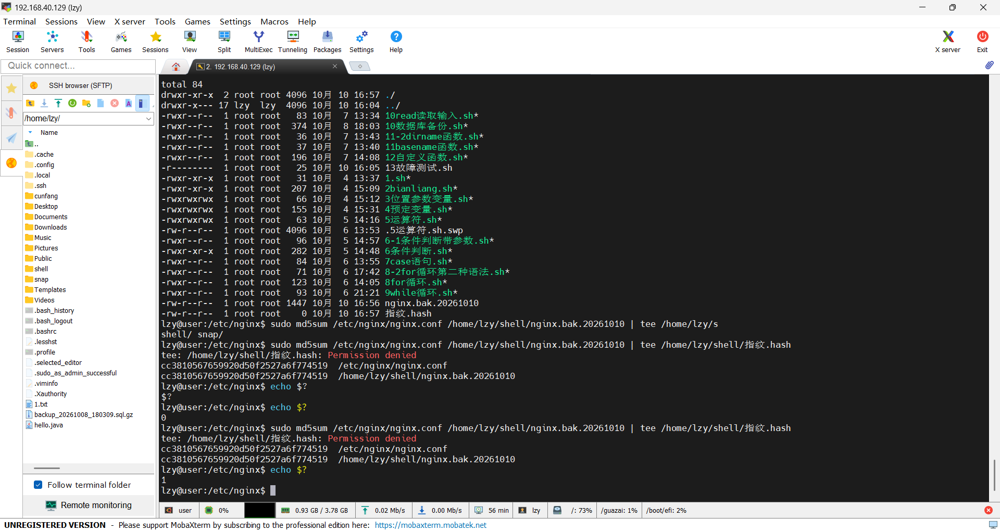
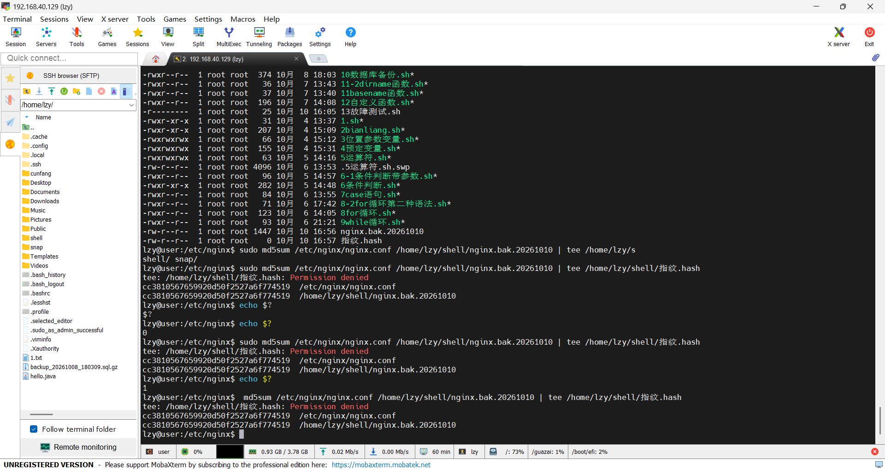
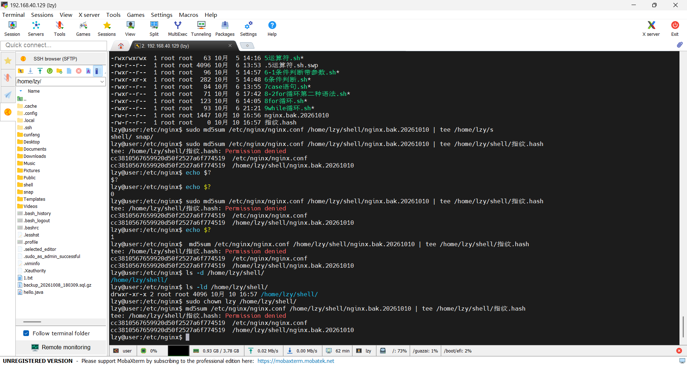
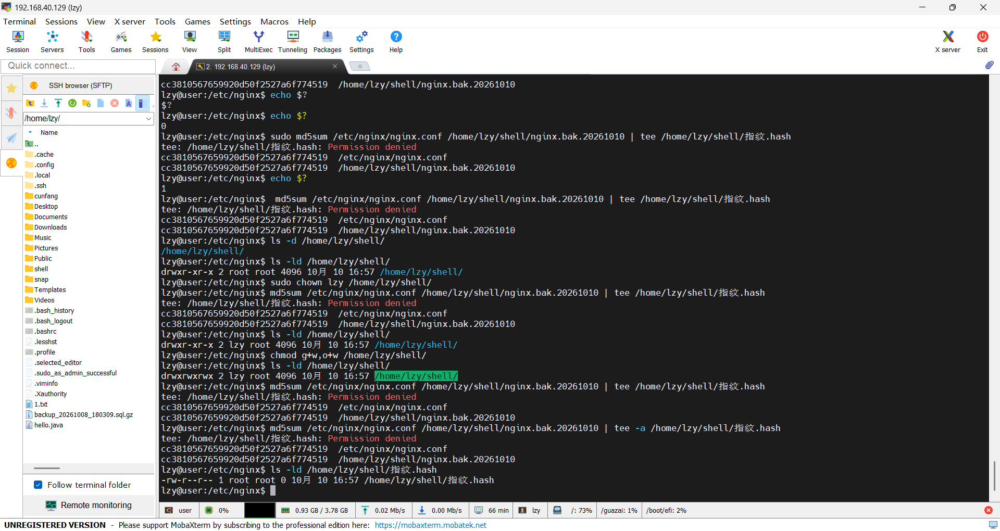
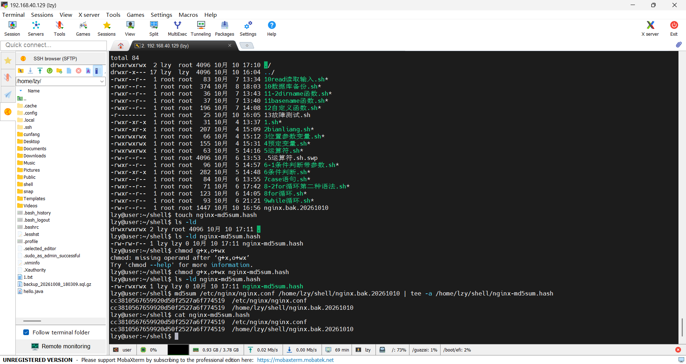

# 一次文件权限问题的排查记录

环境:Ubuntu 22.04(VMware 虚拟机)· 时间:2026-10-10 16:59 ~ 17:12

---

## 一、背景

在修改 nginx 配置之前,先备份配置并记录指纹,以便事后验证恢复是否干净。

```bash
sudo cp /etc/nginx/nginx.conf /home/lzy/shell/nginx.bak.20261010
```

备份执行成功,两个文件的指纹一致:

```
cc3810567659920d50f2527a6f774519  /etc/nginx/nginx.conf
cc3810567659920d50f2527a6f774519  /home/lzy/shell/nginx.bak.20261010
```

---

## 二、现象

创建指纹记录文件,并把指纹写进去:

```bash
touch /home/lzy/shell/指纹.hash
sudo md5sum /etc/nginx/nginx.conf /home/lzy/shell/nginx.bak.20261010 | tee -a /home/lzy/shell/指纹.hash
```

报错:

```
tee: /home/lzy/shell/指纹.hash: Permission denied
```

**注意:命令的前半段是成功的。**屏幕上打印出的两个 md5 值完全一致,说明备份本身没有问题;失败的只有最后"写入记录文件"这一步。



---

## 三、排查过程

### 尝试 1:会不会是 sudo 的问题?

去掉 `md5sum` 前面的 sudo,再执行一次:

```bash
md5sum /etc/nginx/nginx.conf /home/lzy/shell/nginx.bak.20261010 | tee -a /home/lzy/shell/指纹.hash
```

报错一字未变。



### 尝试 2:会不会是目录权限的问题?

```bash
ls -ld /home/lzy/shell/
# drwxr-xr-x 2 root root 4096 ... /home/lzy/shell/     ← 目录属主是 root

sudo chown lzy /home/lzy/shell/      # 把目录属主改成 lzy
sudo chmod g+w,o+w /home/lzy/shell/  # 放开权限,结果变成 drwxrwxrwx
```

报错仍未解决。



### 尝试 3:追加模式能不能绕过去?

`tee` 试一次、`tee -a` 再试一次,**两个都失败**。到这里已经是第 5 次尝试,报错一字未变。


> **该停下来的信号**:同一个报错连续出现两次以上,说明自己改的东西和根因无关。前面几次改的都是**目录**,而报错指向的是**文件**。

### 转折:顺着报错里的路径去看那个文件

```bash
ls -l /home/lzy/shell/指纹.hash
# -rw-r--r-- 1 root root 0 ... /home/lzy/shell/指纹.hash
```



---

## 四、根因

`/home/lzy/shell/指纹.hash` **这个文件已经存在**,属主是 `root`、权限 `644`。

`tee` 是以普通用户 `lzy` 的身份打开这个文件做**覆盖写入**的,而该文件对 others 只给了 `r`(读)、没有 `w`(写),所以被拒绝。

**关键区分:**

| 操作 | 需要谁的权限 |
| --- | --- |
| 在目录里新建 / 删除文件 | **目录**的 `w`(+`x`) |
| 改写已有文件的内容 | **文件自己**的 `w` |

前面几次一直在改目录,方向从一开始就错了——**报错信息里写的路径,指向的是文件。**

---

## 五、修复

```bash
rm /home/lzy/shell/指纹.hash
md5sum /etc/nginx/nginx.conf /home/lzy/shell/nginx.bak.20261010 | tee /home/lzy/shell/nginx-md5sum.hash
```

删除该文件后重新创建,属主就变成自己;同时把文件名换成 ASCII,避免以后在脚本或跨系统场景里出现编码问题。

> **注意因果**:"删除后重建"才是解决权限问题的关键;改用 ASCII 文件名只是顺手做的整理。**换名字解决不了权限问题**,不要记反。

---

## 六、验证

```bash
cat /home/lzy/shell/nginx-md5sum.hash
```

```
cc3810567659920d50f2527a6f774519  /etc/nginx/nginx.conf
cc3810567659920d50f2527a6f774519  /home/lzy/shell/nginx.bak.20261010
```

指纹与备份前记录的值一致,记录文件正常写入。



---

## 七、这次学到的

1. **报错里出现某个路径,下一步就是去看那个路径指向的对象本身**,而不是去看它所在的目录。
2. **同一个报错重复出现,说明改的地方和根因无关。**连续两次就该停下来重新审视方向。
3. **目录权限 ≠ 文件权限**:新建/删除看目录,改写内容看文件。
4. `echo $?` 只反映**紧挨着它的上一条命令**的退出码。管道里拿到的是最后一条命令的;连敲两次 `echo $?`,第二次得到的是第一次 `echo` 自己的退出码。
5. 如果当时没找到根因,下一步该查:**文件的属主和权限位**(`ls -l`)、**当前身份**(`id`)、**SELinux/AppArmor**(Ubuntu 上默认不启用,但值得确认)。

---


